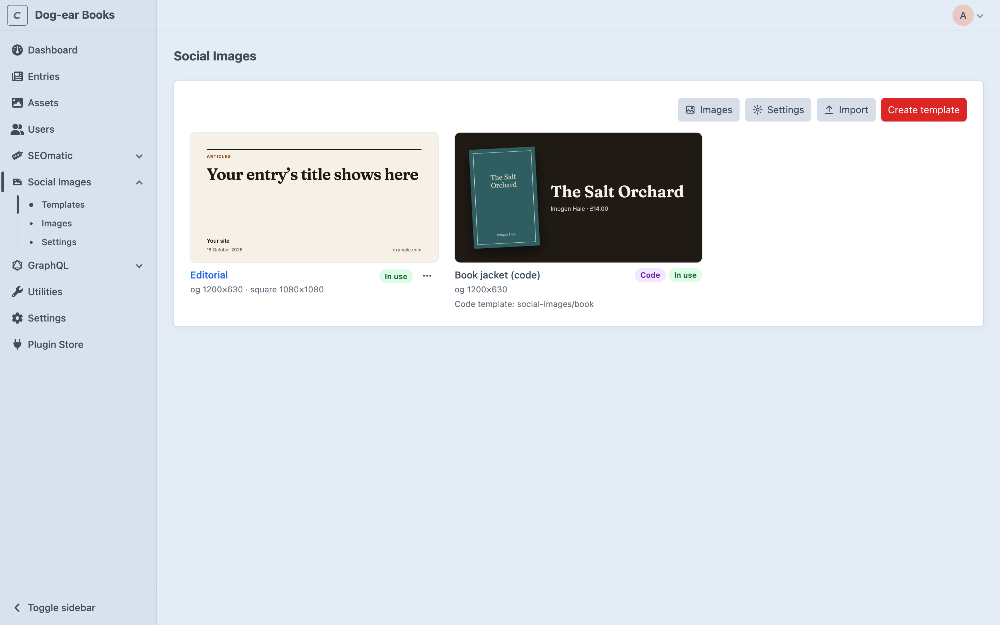
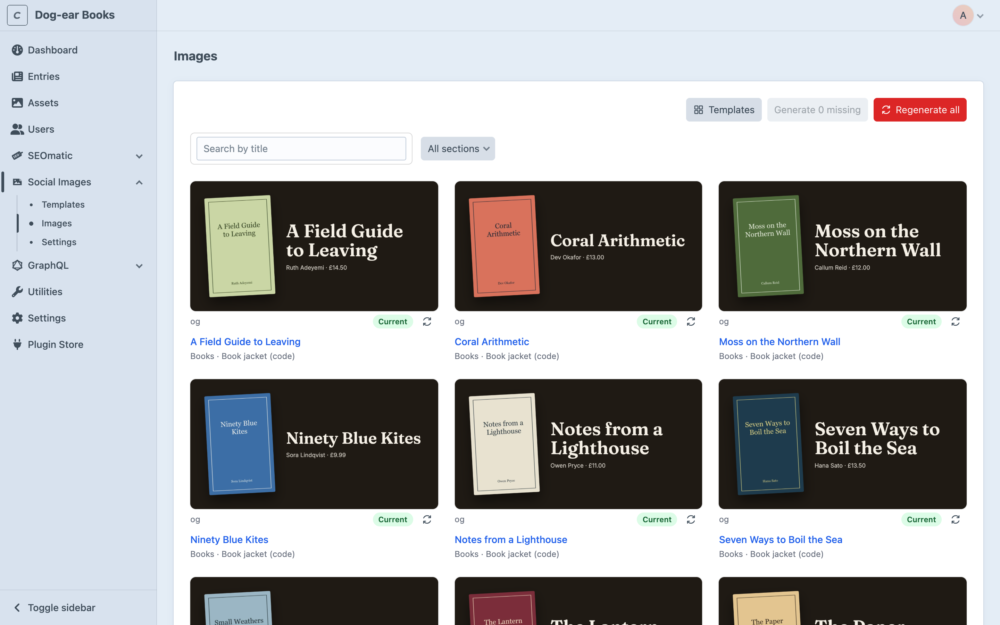
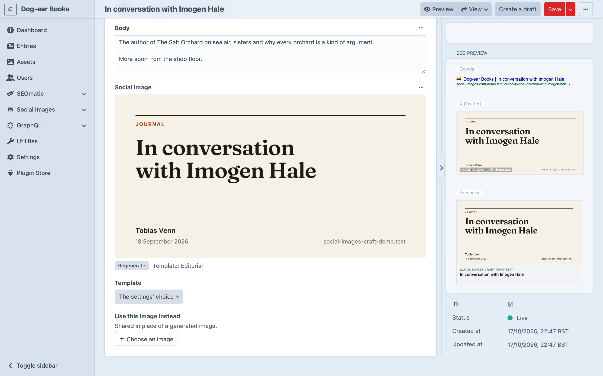

# The control panel

Everything is under **Social Images** in the control panel's sidebar: **Templates**, **Images** and, for admins, **Settings**.

## Templates

Every template, with a preview and how many settings rules use it. Designer templates are previewed with sample text, code templates with a recent entry that uses them. **Create template** starts one from a starter or blank; **Import** adds one from JSON (see [Importing and exporting](importing.md)). Each designer template's **⋯** menu can edit, duplicate, export or delete it. [Code templates](code-templates.md) are listed too, marked **Code**; they're edited as files.

Templates are kept in Project Config, so creating, importing, editing, duplicating and deleting them only work where admin changes are allowed. Elsewhere the page lists them, and exporting still works.

Deleting a template that rules use leaves their entries with no image until you choose another.

## The designer

See [The designer](designer.md).

## Images

Every entry that has a template, in each of its sites, with each of its images and whether it's current. Search by title, or show one section.

- An image that's out of date (its entry or template changed) shows the image still in use, faded, marked **Out of date**.
- **Generate missing** (or **Update out of date**) makes the images that don't exist yet or are out of date.
- **Regenerate all** remakes them all, even current ones.
- The **Regenerate** button (↻) beside an image remakes just that one.

Runs go one image at a time from the page, so you can watch them land and **Stop** at any point. If the screenshot service says it's busy, the run waits and tries again, with a countdown; if it keeps refusing, it stops and says so (see [Limits](rendering.md#limits)). Images already made are kept.

## Settings

**Social Images → Settings**: which template entries use, extra sizes, generating on save, the fallback image, where images are saved, a test render, and SEOmatic. See [Choosing templates](choosing-templates.md), [Configuration](configuration.md#the-settings-page) and [SEOmatic](seo.md).

The settings are saved to Project Config. Only admins can open them, and only where admin changes are allowed can they be changed.

## In an entry

Add a **Social image** field to an entry type's field layout (see [Installation](installation.md#first-steps)) and each entry shows:

- **The image**, as it is now. When it's missing or out of date (the entry or its template changed), opening the entry starts making it, and the field shows the previous image (if there is one) with where it's got to: **Waiting to start…** while it's queued, then **Rendering…** with a count of seconds. It swaps in the new image when it's ready, usually in a few seconds.
- **Regenerate**, to remake it now (for instance after replacing an asset's file in place).
- **Template**: **The settings' choice** to use the rules, or another template, or **None**.
- **Use this image instead**: an image asset of your own to share for this entry.

The preview shows the saved entry, in the site you're editing: save to see changes. Drafts don't get images of their own.

## On the entries index

Select entries and choose **Regenerate social images** from the actions to remake theirs in the queue.

## Permissions

Under each user group's (or user's) permissions, in the **Social Images** section:

- **View social images**: the Templates and Images pages. The Images page lists only entries the user can view.
- **Manage social image templates**: the designer (and its real renders), fonts and uploads, importing, exporting, duplicating and deleting templates, the settings' **Test** button, **Regenerate social images** on the entries index, and remaking any entry's image.

Previewing a template with an entry shows that entry's values, so the designer only offers (and only accepts) entries the user can view.

Anyone who can view an entry sees its image in the field. Anyone who can save an entry can remake its image, from the entry or the Images page. Settings are for admins only.
